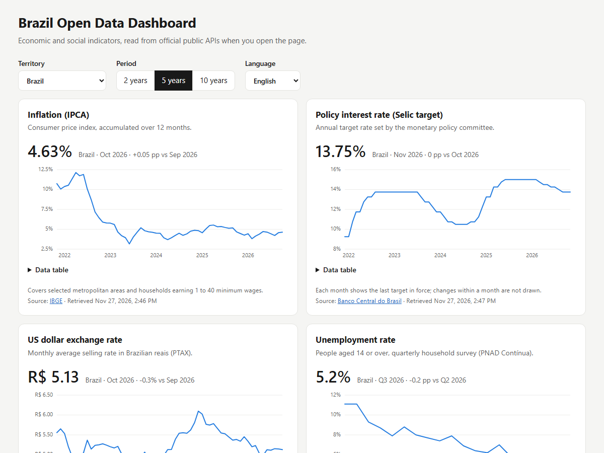

# Brazil Open Data Dashboard

[](https://github.com/ericrc77/brazil-open-data-dashboard/actions/workflows/ci.yml)

Economic and social indicators of Brazil, read from the official **IBGE** and **Banco Central do Brasil** APIs at
the moment you open the page. English and Portuguese, with state-level views where the source publishes them.

**[Live demo](https://ericrc77.github.io/brazil-open-data-dashboard/)**



## What it does

- Seven indicators with latest value, change against the previous period, chart and data table.
- State filter, comparing a state with the national figure where both share a scale.
- Period filter (2, 5 or 10 years), with filters kept in the address so a view can be shared.
- Loading, error, retry and empty states per indicator: one source failing does not break the others.
- Keeps the last download in the browser and says so when the source is unavailable.
- Keyboard-accessible charts, light and dark themes, mobile layout.

## Data sources

| Indicator | Publisher and series | Frequency | By state |
|-----------|----------------------|-----------|----------|
| Inflation, IPCA 12 months | IBGE, table [1737](https://sidra.ibge.gov.br/tabela/1737), variable 2265 | monthly | no |
| Selic target rate | Banco Central, SGS series 432 | monthly (last value) | no |
| US dollar, monthly average selling rate | Banco Central, SGS series 3698 | monthly | no |
| Unemployment rate | IBGE, table [4099](https://sidra.ibge.gov.br/tabela/4099), variable 4099 | quarterly | yes |
| GDP volume, four-quarter accumulated | IBGE, table [5932](https://sidra.ibge.gov.br/tabela/5932), variable 6562 | quarterly | no |
| Estimated resident population | IBGE, table [6579](https://sidra.ibge.gov.br/tabela/6579), variable 9324 | annual | yes |
| Illiteracy rate, 15 years or older | IBGE, table [7113](https://sidra.ibge.gov.br/tabela/7113), variable 10267 | annual | yes |

Up to ten years of history are requested.

### Limitations

- Values are shown as published. Publishers revise past periods, so numbers can change.
- Missing periods appear as gaps; nothing is interpolated. Some years have no population or illiteracy figure.
- Survey results (unemployment, illiteracy) have wider margins of error for states; margins are not displayed.
- The Selic series lists future dates until the next policy meeting. Those are discarded.
- Availability depends on the two public APIs.

## Architecture

```text
src/data         indicator catalog, parsers, fetching with cache (no React)
src/hooks        loading state and URL filters
src/components   cards, data table and a dependency-free SVG line chart
src/i18n         English and Portuguese texts and number formatting
```

- **No backend.** Both APIs allow cross-origin requests, so a static site is enough and free to host.
- **Declarative catalog.** A new indicator is one entry in `src/data/indicators.ts` plus its texts.
- **Resilient loading.** 20-second timeout, one retry for server and network errors, six-hour cache, stale fallback.
- **Small chart component** instead of a charting library; React is the only runtime dependency.
- **Content Security Policy** allows connections only to the two publishers.

## Development

Requires Node.js 22.13 or newer.

```bash
npm ci
npm run dev     # http://127.0.0.1:5174
npm run check   # lint, type check, tests and build
```

No environment variables or API keys are needed. Pushing to `main` runs the checks and deploys to GitHub Pages.

## History

This project replaces two earlier prototypes that displayed placeholder and randomly generated values.

## License

Code under [MIT](LICENSE). Data belongs to IBGE and Banco Central do Brasil; credit them when reusing it. This is
an independent project, not affiliated with either institution.
